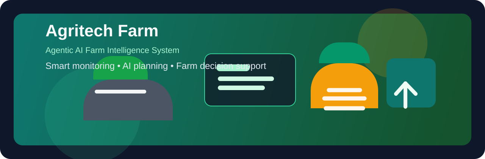

# 🌾 Hack Devengers 1.0 — Agentic AI Farm Intelligence System



> Autonomous, multi-agent farm intelligence platform for crop monitoring, risk analysis, planning, and decision support — built for **Hack Devengers 1.0**.

[](https://www.python.org/downloads/)
[](https://fastapi.tiangolo.com/)
[](LICENSE)
[](https://github.com/Vansh-Thakur-Sadyal/Hack-Devengers-1.0)
[](#-deployment--hosting-vps--domain)

---

## 🌐 Deployment & Hosting (VPS + Domain)

> **This project is live in production. The website is hosted on a self-managed VPS (Virtual Private Server) and served to the public through a custom domain.**

The application does **not** run on a shared/serverless platform — it is deployed and operated end-to-end on a dedicated VPS that the team controls, and the public traffic is routed to it through a registered custom domain.

### How the hosting works

```text
        Users / Judges
              │
              ▼
   Custom Domain (DNS A record)   ← "Vision Coders" domain points to the VPS public IP
              │
              ▼
   ┌───────────────────────────────────────┐
   │              VPS (Linux)               │
   │                                        │
   │   Reverse Proxy (Nginx / Apache)       │  ← handles HTTP/HTTPS + TLS certificate
   │      │                    │            │
   │      ▼                    ▼            │
   │  Static Frontend     FastAPI Backend   │
   │  (HTML/CSS/JS)       (Uvicorn)   │
   │                          │             │
   │                          ▼             │
   │              Multi-Agent Orchestrator  │
   │              + Mistral AI integration  │
   └───────────────────────────────────────┘
```

### Hosting summary

| Layer            | What runs there                                                      |
| ---------------- | -------------------------------------------------------------------- |
| **VPS**          | A dedicated Linux Virtual Private Server owned/managed by the team.   |
| **Domain**       | A registered custom domain whose DNS points to the VPS public IP.     |
| **Web server**   | A reverse proxy (Nginx/Apache) terminates TLS and routes requests.    |
| **Frontend**     | Static dashboard (HTML/CSS/JS) served over the domain.               |
| **Backend**      | FastAPI app served by Uvicorn, proxied behind the web server.        |
| **AI layer**     | Mistral AI API, called securely using a key stored **only** on the VPS in a private `.env` file (never committed). |
| **Process mgmt** | The backend runs as a long-lived service (e.g. `systemd`) so it stays online. |

### Deployment flow (high level)

1. Point the custom domain's DNS **A record** at the VPS public IP address.
2. Clone this repository onto the VPS and install dependencies (`pip install -r requirements.txt`).
3. Create a private `.env` file **on the VPS** with the real secrets (see [Configuration](#4-configure-environment-variables)).
4. Run the FastAPI backend with Uvicorn as a background service.
5. Configure the reverse proxy (Nginx/Apache) to serve the frontend and proxy `/api` requests to the backend, and enable an HTTPS/TLS certificate for the domain.
6. The site is then reachable publicly at the custom domain. ✅

> 🔐 **Security note:** The Mistral API key and any other secrets live **only** on the VPS inside a `.env` file that is excluded by `.gitignore`. No API keys are stored in this repository — see [`.env.example`](.env.example) for the required variable names.

---

## 🎯 Overview

The Agentic AI Farm Intelligence System is a smart agricultural platform that combines modern web interfaces, FastAPI services, and specialized AI agents to assist farmers and agricultural teams with real-time farm monitoring, crop recommendations, disease awareness, and automated planning.

This project is designed to turn raw field telemetry and agricultural data into practical, actionable decisions.

### What this system does
- Collects and standardizes farm-related data such as soil moisture, temperature, humidity, and crop context.
- Uses AI-driven analysis for crop recommendations and disease-focused insights.
- Orchestrates multiple specialized agents to create a complete farm decision pipeline.
- Exposes a backend API for dashboard integration and automation.
- Offers an interactive frontend experience for visualizing telemetry and running the pipeline.

---

## 🧠 Core Architecture

The system follows a modular flow:

1. Frontend dashboard collects user inputs and sends them to the backend.
2. FastAPI receives requests and routes them to the orchestrator.
3. The orchestrator runs the workflow across specialized agents.
4. Results are returned to the UI and can be used for monitoring or planning.

### High-level workflow
```text
Frontend Dashboard
        ↓
FastAPI Backend
        ↓
Agent Orchestrator
   ├─ Agent 1: Data Collection & Standardization
   ├─ Agent 2: Analytics & Risk Intelligence
   ├─ Agent 3: Decision Planning
   ├─ Agent 4: Monitoring & Feedback
   └─ Agent 5: Memory & Learning
```

---

## 🤖 Agent Roles

### Agent 1: Data Collection & Standardization
Handles the ingestion of field-related inputs and prepares them for downstream analysis.

Features include:
- Sensor and environmental data handling
- Data cleaning and validation
- Standardized field records for analysis
- Storage support for processed information

### Agent 2: Analytics & Risk Intelligence
Processes farm conditions to detect risks, analyze trends, and provide insight for crop health and planning.

Features include:
- Crop and field analysis
- Disease-aware recommendations
- Rule-based and ML-assisted evaluation
- Risk scoring and monitoring insights

### Agent 3: Decision Planning
Transforms analysis results into practical strategies such as irrigation suggestions, resource planning, and recommendation actions.

Features include:
- Strategy generation
- Planning support for yield and sustainability goals
- Integration with monitoring and memory workflows

### Agent 4: Monitoring & Feedback
Continuously observes farm conditions, assesses risk patterns, and provides feedback for safer and more reliable operations.

Features include:
- Real-time performance monitoring
- Alert generation for stress signals
- Feedback to improve agent decisions
- Health and risk tracking

### Agent 5: Memory & Learning
Maintains historical system data, remembers past runs, and helps the system learn from previous outcomes.

Features include:
- Memory storage for past workflows
- Learning from historical performance
- Better recommendations over time
- Support for adaptive planning

---

## ✨ Key Features

- Real-time dashboard experience for farm monitoring
- Multi-agent orchestration for agriculture workflows
- FastAPI-powered backend with REST endpoints
- Chat-style interaction for quick agricultural queries
- Crop and disease analysis support
- Workflow tracking and progress reporting
- Easy extension for future planning, forecasting, and storage integrations

---

## 🛠️ Technology Stack

### Backend
- Python
- FastAPI
- Uvicorn
- Pydantic-style request handling

### Frontend
- HTML
- CSS
- JavaScript
- Interactive dashboard UI

### AI & Data Layer
- Mistral AI LLM integration (model configurable in `backend/llm_client.py`)
- Data processing and analysis modules
- Optional support for storage and database-backed extensions

### Hosting & Ops
- Self-managed **VPS** (Linux)
- Custom **domain** with DNS pointing to the VPS
- Reverse proxy (Nginx/Apache) with TLS/HTTPS
- Long-running backend service (e.g. `systemd`)

---

## 📁 Project Structure

```text
Hack-Devengers-1.0/
├── backend/
│   ├── agents/
│   │   ├── agent1/
│   │   ├── agent2/
│   │   └── agent3/
│   ├── api/
│   ├── llm_client.py
│   └── logs/
├── frontend/
│   ├── index.html
│   ├── index.js
│   ├── index.css
│   ├── dashboard2.html
│   ├── dashboard2.js
│   └── dashboard2.css
├── assets/
├── .env.example
├── README.md
├── requirements.txt
└── .gitignore
```

---

## 🚀 Getting Started (Local Development)

### Windows quick start
```powershell
git clone https://github.com/Vansh-Thakur-Sadyal/Hack-Devengers-1.0.git
cd Hack-Devengers-1.0
python -m venv .venv
.venv\Scripts\Activate.ps1
pip install -r requirements.txt
```

### 1. Clone the repository
```bash
git clone https://github.com/Vansh-Thakur-Sadyal/Hack-Devengers-1.0.git
cd Hack-Devengers-1.0
```

### 2. Create and activate a virtual environment
```bash
python -m venv .venv
# Windows
.venv\Scripts\activate
# macOS/Linux
source .venv/bin/activate
```

### 3. Install dependencies
```bash
pip install -r requirements.txt
```

### 4. Configure environment variables
Copy the sample file and fill in your real values:

```bash
cp .env.example .env
```

Then edit `.env` and set at least:

```env
MISTRAL_API_KEY=your-mistral-api-key-here
```

> ⚠️ The real `.env` file is **git-ignored** and must never be committed. Keep your Mistral API key private.

### 5. Start the backend
Make sure you have created and activated your virtual environment and installed `requirements.txt` first.

```bash
cd backend
python -m uvicorn api.server:app --reload --host _____ --port ___
```

This command runs the FastAPI backend server with live reload enabled.

### 6. Start the frontend
From the project root, open the frontend in a simple static server:

```bash
cd frontend
python -m http.server ___
```

Then visit:
- http://localhost:___/index.html
- http://localhost:___/docs for FastAPI docs

---

## 🖥️ Demo Preview

A simple dashboard experience is included for interacting with the system and observing the coordinated farm intelligence workflow.


You can expect to see:
- a control panel for farm inputs and field conditions
- agent-driven analysis results
- a chatbot-style interaction panel
- monitoring and planning feedback from the backend pipeline

---

## 🔌 API Endpoints

The backend exposes the following main endpoints:

- POST `/run-agent` — runs the full farm intelligence pipeline
- POST `/chat` — sends a natural-language agricultural query
- GET `/progress` — retrieves current pipeline progress information
- POST `/apply-strategy` — saves a recommended strategy into memory

Example request:
```bash
curl -X POST http://127.0.0.1:8001/run-agent \
  -H "Content-Type: application/json" \
  -d '{"query":"Analyze field conditions","agent1":{},"agent2":{},"agent3":{}}'
```

---

## 📦 Running the Dashboard

The frontend is a lightweight dashboard for interacting with the system. It lets you:
- adjust farm parameters
- trigger analysis runs
- visualize system health
- interact with the chatbot interface

The dashboard communicates with the backend (locally at `http://__________`, and in production through the hosted domain via the reverse proxy).

---

## 🤝 Contributing

Contributions are welcome.

1. Fork the repository
2. Create a feature branch
3. Make your changes
4. Commit and push your branch
5. Open a pull request

Please keep code clean, document new features, and add tests where appropriate.

---

## 📄 License

This project is licensed under the **Apache License 2.0** — see the [LICENSE](LICENSE) file for details.

---

## 🙌 Acknowledgment

Built for **Hack Devengers 1.0** as an intelligent agriculture platform to support smarter crop monitoring, planning, and decision-making with the help of AI-driven workflows — deployed live on a VPS with a custom domain.
